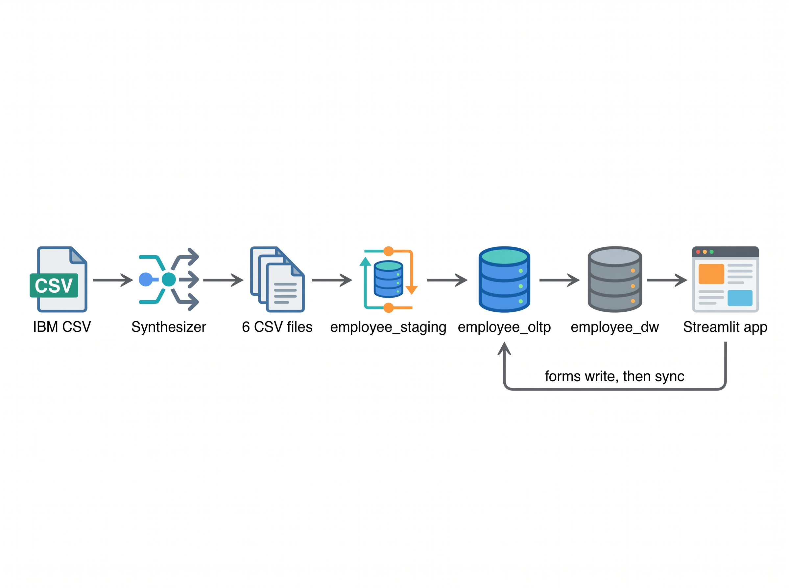

# Enterprise Employee Analytics & Data Warehouse

An end-to-end HR analytics platform: a synthetic 100,000-employee dataset, a normalized operational database (OLTP), a star-schema data warehouse (OLAP) with **SCD Type 2** history, and a **Streamlit** web app for data entry and dashboards.

**Live app:** `https://projectteam7employeeanalyticsanddatawarehousing.streamlit.app/` 

## What it does

- **Synthesizes** realistic HR data from the 1,470-row IBM HR Attrition dataset, including projects, assignments, yearly reviews and job-change history.
- **Stores** current state in a normalized OLTP database and full history in a star-schema warehouse.
- **Tracks history (SCD Type 2):** a department, role, level or salary change closes the old warehouse row and opens a new one, so every review is attributed to the department the employee was in *on the review date*.
- **Serves** forms (onboard employee, edit employee, create project, submit review) and dashboards (performance trends, top performers, attrition risk, project bottlenecks).

## Architecture

```

```

| Layer | Database | Role |
|---|---|---|
| Staging | `employee_staging` | Raw copy of the CSVs. Used by ETL only. |
| OLTP | `employee_oltp` | Normalized, current state. The app writes here. |
| OLAP | `employee_dw` | Star schema: `Dim_Employee` (SCD2), `Dim_Department`, `Dim_Project`, `Dim_Date`, `Fact_PerformanceReviews`, `Fact_ProjectAllocations`. Dashboards read here. |

## Key numbers (synthetic data)

| Item | Value |
|---|---|
| Employees | 100,000 (about 83,900 active, 16.1% attrition) |
| Performance reviews | about 490,000 |
| Projects | 1,500 |
| Employees with job history | about 37,800 |
| Warehouse employee versions | about 160,000 |

## Tech stack

Python 3.12, `uv`, pandas, Faker, MySQL 8, Streamlit, Plotly, pytest.

## Repository layout

```
app/          Streamlit app: main.py (navigation), data.py (cached data access), views/ (pages)
src/
  synthesizer/  Data generation (pandas + Faker)
  etls/         Staging loader and ETL runners with reconciliation checks
  database/     DatabaseConnection (Singleton + pooling), BaseManager, exceptions
  entities/     Employee, Project, Review
  managers/     Data access layer (Employee, Project, Review, Analytics, WarehouseSync)
sql/
  staging/ oltp/ olap/ etl/   DDL, stored procedures, CTEs and window functions
data/         raw IBM CSV (input) and generated CSVs (git-ignored)
test/         Unit tests
docs/         Design notes and diagrams
```

## Getting started

**Prerequisites:** [uv](https://docs.astral.sh/uv/), MySQL Server 8.0+, Git.

```bash
git clone <repo-url> && cd <repo-folder>
uv sync
cp .env.example .env        # Windows: copy .env.example .env
```

Edit `.env` with your MySQL password.

**1. Generate data** (seeded, so every run is identical):

```bash
uv run python -m src.synthesizer.pipeline
uv run python -m src.synthesizer.validate     # every line should print PASS
```

**2. Create databases and procedures** (order matters; each DDL drops its database):

```bash
mysql -u root -p < sql/staging/01_staging_ddl.sql
mysql -u root -p < sql/oltp/01_oltp_ddl.sql
mysql -u root -p < sql/oltp/02_load_from_staging.sql
mysql -u root -p < sql/olap/02_olap_ddl.sql
mysql -u root -p < sql/etl/03_etl_procedure.sql
mysql -u root -p < sql/etl/05_dim_employee.sql
```

**3. Load data** (each script prints PASS/FAIL reconciliation checks):

```bash
uv run python -m src.etls.load_staging      # CSV -> staging
uv run python -m src.etls.run_oltp_load     # staging -> OLTP
uv run python -m src.etls.run_dw_etl        # OLTP -> warehouse
```

**4. Run the app:**

```bash
uv run streamlit run app/main.py
```

## App pages

| Page | Purpose |
|---|---|
| Overview | KPIs, yearly performance trend, headcount, project status |
| Performance | Trend by department; top performers per department (`DENSE_RANK`) |
| Attrition | Attrition rate by driver; rule-based risk list of current employees |
| Bottlenecks | Project delay, overdue projects, employee over-allocation |
| Employees / Projects | Onboard employee, create project, search |
| Reviews | Submit a performance review (syncs to the warehouse) |
| Edit employee | Change department, role, level or pay (creates an SCD2 version) |

## Design decisions

- **SCD Type 2 windows are `[start_date, end_date)`.** A closed version's end date equals the next version's start date; the current version ends at `9999-12-31`. Facts join on `date >= start AND date < end`.
- **Write path.** Forms save to OLTP in one transaction (with an audit log), then call an incremental stored procedure to update the warehouse. If the sync fails, the data stays saved, the user sees a warning, and a retry button is provided.
- **Data layer.** `DatabaseConnection` is a per-class Singleton with connection pooling. Managers inherit from `BaseManager`, which provides transactions and translates MySQL errors into `DataAccessError` types with user-safe messages.
- **Pages contain no SQL.** They call `app/data.py`, which calls managers.

## Configuration (`.env`)

| Variable | Meaning |
|---|---|
| `DB_HOST`, `DB_PORT`, `DB_USER`, `DB_PASSWORD` | MySQL connection |
| `DB_STAGING`, `DB_OLTP`, `DB_DW` | Database names (defaults: `employee_staging`, `employee_oltp`, `employee_dw`) |
| `DB_POOL_SIZE` | Connections per database pool (default 5) |
| `DB_SSL_CA` | Optional path to a CA bundle for cloud MySQL |

Never commit `.env`. In Streamlit Community Cloud, use the app's Secrets settings.

## Testing

```bash
uv run pytest
```

Data-layer tests use a fake connection pool and need no MySQL server. ETL scripts include row-count, orphan-record and SCD2 continuity checks (13 for OLTP, 9 for `Dim_Employee`, 8 for the warehouse).

## Known limitations

- All data is synthetic; trends are illustrative, not real insight.
- The attrition risk score is a transparent rule-based heuristic, not a trained model.
- `run_dw_etl` rebuilds `Dim_Employee` from staged history. Use it for resets only, as it discards versions created through the app.
- Some reviews have no reviewer in the warehouse (the generator can pick a manager hired after the review).

## Team

Soham Patil
Revathy P
Mrunali Baviskar